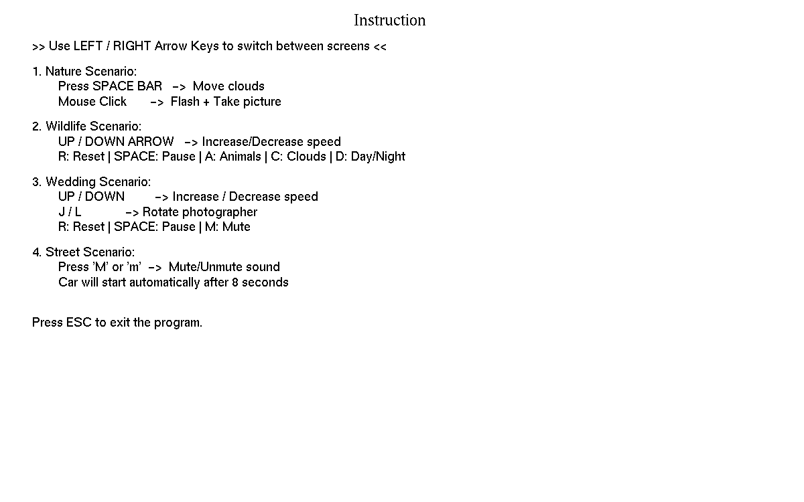
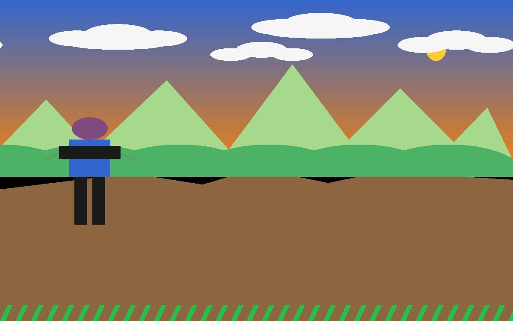
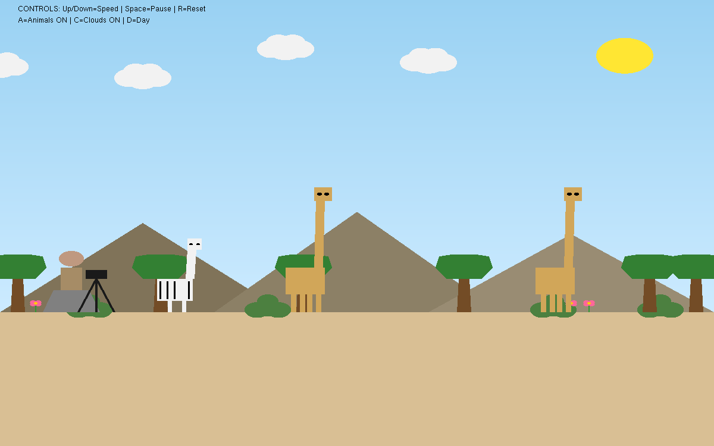
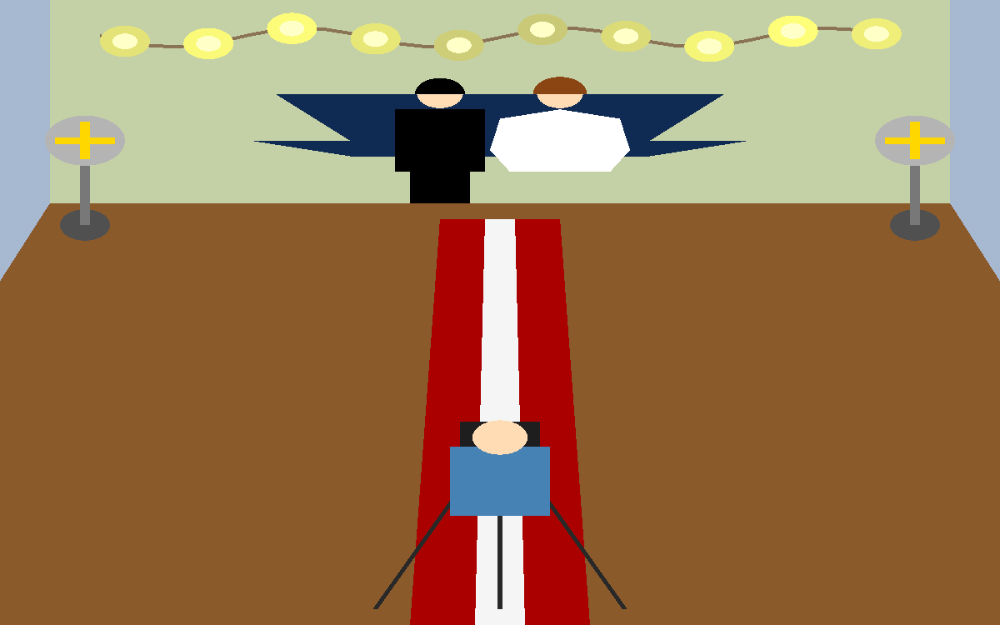
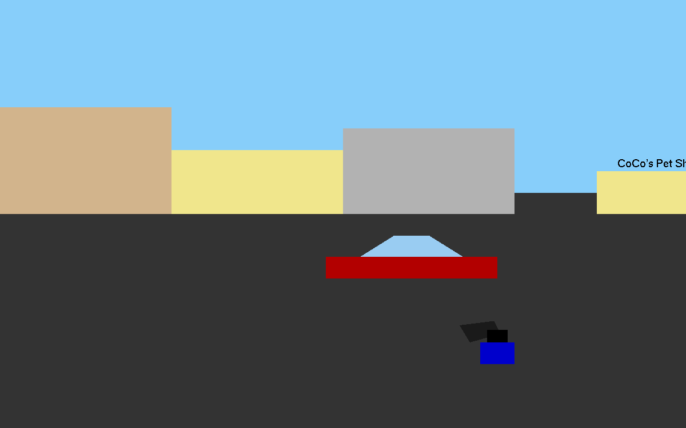

# Merged CG Project (OpenGL / GLUT)

A computer graphics project made with **C++ and OpenGL (GLUT)**.
It has 4 animated scenes and 1 instruction page. You can switch between them with the arrow keys.

## Screenshots

### 0. Instruction Page


### 1. Nature Scene


### 2. Wildlife Scene


### 3. Wedding Scene


### 4. Street Scene


## Controls

**Global**

| Key | Action |
|-----|--------|
| `Left` / `Right` arrow | Go to the previous / next scene |
| `ESC` | Exit the program |

**Scene 1 - Nature**

| Key | Action |
|-----|--------|
| `Space` | Start moving the clouds |
| Mouse click | Take a picture (up to 3) |

**Scene 2 - Wildlife**

| Key | Action |
|-----|--------|
| `Up` / `Down` arrow | Increase / decrease speed |
| `Space` | Pause |
| `A` | Animals on/off |
| `C` | Clouds on/off |
| `D` | Day / Night |
| `R` | Reset |

**Scene 3 - Wedding**

| Key | Action |
|-----|--------|
| `Up` / `Down` arrow | Increase / decrease speed |
| `J` / `L` | Rotate the photographer |
| `Space` | Pause |
| `M` | Mute / unmute music |
| `R` | Reset |

**Scene 4 - Street**

| Key | Action |
|-----|--------|
| `M` | Mute / unmute sound |

## Requirements

- Windows (the code uses `windows.h` and `PlaySound`)
- A C++ compiler (for example MinGW-w64 / g++)
- OpenGL and **freeglut**

## Audio Files

Put these `.wav` files in the **same folder as the program** (the folder you run it from):

- `nature.wav`
- `project_sound.wav`
- `Wedding.wav`
- `mixkit-cars-starting-1561.wav`

The program still runs without them, but there will be no sound.

## Build and Run

With MinGW (g++):

```bash
g++ main.cpp -o main -lfreeglut -lopengl32 -lglu32 -lwinmm
./main
```

With Code::Blocks or Visual Studio: create a new project, add `main.cpp`, and link `freeglut`, `opengl32`, `glu32` and `winmm`.

## Project Structure

├── main.cpp          # Full source code (all scenes)
├── README.md
├── .gitignore
└── screenshots/      # Pictures used in this README
    ├── 01-instruction.png
    ├── 02-nature.png
    ├── 03-wildlife.png
    ├── 04-wedding.png
    └── 05-street.png


## Team Members

This is a group project for the Computer Graphics course.

| Name | Student ID | Scene / Work |
|------|------------|--------------|
| Progga Fariba Haq |23-53232-3| e.g. Nature scene |
| Member 2 | 00-00000-0 | e.g. Wildlife scene |
| Member 3 | 00-00000-0 | e.g. Wedding scene |
| Member 4 | 00-00000-0 | e.g. Street scene |
